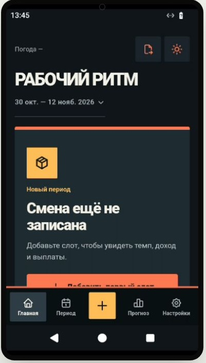
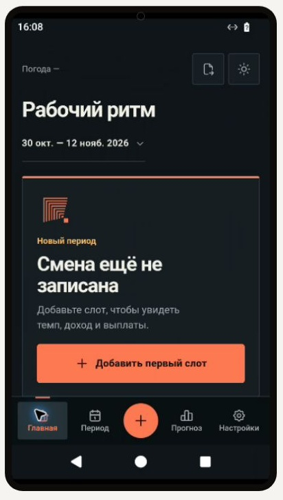

# Unslop UI audit · 2 November 2026

**Current scope:** full SHIFT CONTROL interface redesign and owner-referenced staircase app mark. Forecast calculations, business rules, records, navigation actions, and storage are protected. The current QA candidate launched and was visually reviewed on SpawnDroid Android 15; the PR remains a draft pending owner acceptance and remaining Android checks. Credit: [Unslop by Damir Sokolovsky](https://github.com/heydamir/unslop), CC BY 4.0.

> The dated reviews below describe earlier, narrower candidates. They are historical evidence only and are superseded by the latest full redesign section at the end of this report.

## Verified baselines

- Base APK source branch: `release/forecast-video-upload-20261101`, commit `1ba9b0d04b47e0c15c99aa6ba0f8edd2d6b2ed25`. The APK obtained from GitHub Actions run [41415151486](https://github.com/xxiamadelxx-blip/sending-couriers/actions/runs/41415151486) contains `assets/www/style.css`, `app.mjs`, and the other UI assets for source inspection. This run is an M4 build, **not a visual Android sign-off**.
- Historical Android 35 dark/light screenshots at 360/390 from [UI audit run 40846918821](https://github.com/xxiamadelxx-blip/sending-couriers/actions/runs/40846918821), artifact `ui-audit-a1340c1d23615893a68dbafc705930578236dda7`. They show Home, Period, Add Slot, Forecast and History, **but are from 29 October and a different SHA**; they are context only, not evidence for this candidate.
- Local technical checks of extracted release APK assets: JS syntax `node --check` PASS; CSS `tinycss2.parse_stylesheet` PASS after the two CSS edits. These checks **do not prove Android visual QA**.

## Android QA · SpawnDroid · 2 November 2026

- Candidate source: branch `ui/unslop-light-polish-20261102`, commit `f366a269219afffe0c41283c823131f1b8cc8525`.
- Device: Android 15 / API 35 phone, Russian locale, 720×1280 px at 320 dpi (360×640 dp).
- Base: `Courier-Finance-1.7.24-base-UI-QA.apk`, package `ru.courier.finance.transfer`, version `1.7.24 (38)`, SHA-256 `d66311209289c967f2b464abd46e974e35d1954f729d98c6d5fdabd336d18008`.
- Candidate: `Courier-Finance-1.7.24-unslop-UI-QA.apk`, same package/version, SHA-256 `a12f08d0adc419d1e586686f9d38e9a47f6af02cf87918e6f9ebab3c2be4c2fb`. It was derived from that base APK with the PR's CSS and signed with a temporary QA key so SpawnDroid could replace the test build. Both test APKs used that QA signer; neither is a production update.
- Synthetic data: one entry for 2 November 2026 with a 320 ₽ reward and unknown hours/orders. The JSON import preview showed 1 record, 1 day, and 0 closed periods on both APKs. Import was cancelled on both; no import was applied.
- Base and candidate import-dialog captures use the same preview data. The candidate's three counter captions are visibly larger; “ЗАКРЫТЫХ ПЕРИОДОВ” still wraps within its tile without colliding with other content. See [base](evidence/unslop-2026-11-02/base-import-dialog.jpg) and [candidate](evidence/unslop-2026-11-02/candidate-import-dialog.jpg).
- On the candidate, Period was checked collapsed and expanded with the synthetic entry. The day-card metadata at 12 px remains legible and inside the card. The expanded-card capture is [here](evidence/unslop-2026-11-02/candidate-period-expanded.jpg). A matched base capture of the expanded card was not retained, so this is a candidate inspection, not a before/after comparison for that screen.
- Candidate UI navigation to History and the import dialog worked. No visual regression was noticed in the tested card treatment, orange accents, or bottom navigation. In the captured viewport, the expanded card continues below the fixed navigation line; full scroll and touch behavior was not validated.
- The SpawnDroid session was stopped after inspection. The candidate is a test artifact only; no release build or installed user app was changed.

## Five-point direction (derived from approved SHIFT CONTROL brand)

1. **Product:** autonomous Android app for tracking courier shifts, money and forecast.
2. **Character:** focused, precise, sturdy.
3. **World:** courier shift instrument panel, graphite night surface with the approved warm orange.
4. **Moments:** the Home pace gauge and financial amount, not decorative badges.
5. **Signature:** existing orange progress/selection treatment and the central +; retain the established brand artwork.

## Unslop audit: observation → action

| Screen / layer | Evidence | Severity | Decision |
| --- | --- | --- | --- |
| Home gauge and money | Historical real Android captures | No established slop | **Keep** layout and emphasized amounts; do not change brand/palette |
| Bottom navigation, centered + | Historical real Android captures and project rules | No established slop | **Keep** icons, order, and shape |
| Period: expandable day-card captions | Latest `web/style.css` had 11px metadata at `.period-day-title small` and `.period-day-figures small` | P3 legibility risk | Change to 12px; no changes to order, data, edit IDs, cards |
| Import dialog: three counter labels | Latest `#importDialog .import-stats small` had 9px text, weight 800 and tracking .08em | P2 legibility risk | Change to 12px, weight 600, tracking 0; preserve strings and three columns |
| App typography beyond these selectors | Large layered historical stylesheet contains additional 10–11px text, bold and uppercase | P3 **inspection needed**, not all are slop | Leave unchanged pending fresh screenshots |
| Brand visuals | Existing gradients belong to user-approved SHIFT CONTROL mark | Protected brand | **Keep**; Unslop generic removal guidance does not override design approval |
| Motion | No demonstrated visual defect | Not confirmed | No changes |
| Forecast model and import | Explicitly out of scope | Protected | No changes |

### Nine Unslop passes · polish mode

1. **Spacing:** retained approved period and nav geometry.
2. **Color:** retained graphite/orange and saved themes.
3. **Icons:** retained Tabler and brand icon.
4. **Copy:** retained precise Russian product wording; no new slogans.
5. **Type:** targeted two caption blocks above.
6. **Layout:** no sections moved, no card dimensions or control behavior changed.
7. **Details:** no new shadows, glows, widgets, or decor.
8. **Visuals:** no generated art or new imagery.
9. **Motion:** unchanged.

## Acceptance: criterion → evidence → status

| Criterion | Evidence / check | Status |
| --- | --- | --- |
| Financial calculations, forecast and storage remain unchanged | CSS-only source diff | **PASS** |
| CSS stays syntactically valid | `tinycss2` parse of candidate CSS | PASS |
| Existing JS remains parseable | `node --check` over extracted APK assets; candidate JS is unchanged | **PASS** |
| Import-counter labels, same synthetic preview, base vs candidate at 360 dp | SpawnDroid screenshots; larger candidate labels, no overlap, third label wraps within its tile | **PASS** |
| Candidate Period collapsed/expanded with a day entry | SpawnDroid candidate screenshot; 12 px metadata fits in the visible card | **PASS** |
| Matched before/after expanded Period card | No retained base expanded-card screenshot | **NOT RUN** |
| Light theme, 390 dp, large text, remaining UI states | Not part of this SpawnDroid pass | **NOT RUN** |
| Restart, edit/save and historical facts remain intact | No force-stop/restart or edit/save validation on this candidate | **NOT RUN** |
| User accepts visual result | Owner review of the attached Android captures | **NOT RUN** |

**Release gate:** this is a limited Android spot check, not full UI acceptance. Do not merge or claim final visual PASS until the owner explicitly approves the screenshots. The draft must not be confused with a production-signed update.

**Next action:** owner reviews the attached captures. Keep the PR draft until that review. If the visual result is rejected, revert the two CSS selectors.

## Follow-up polish — import-dialog labels · 2 November 2026

The real SpawnDroid capture above showed four remaining labels in all caps; the 12-week heading was also 10 px with wide tracking. This matches Unslop's typography findings for uppercase labels and very small text.

- Changed the three existing import counters and the existing cycle heading to sentence case. The cycle heading is now 12 px / weight 600 / zero tracking. Counter captions keep the earlier 12 px size. No labels were added or removed; the wording and import actions are unchanged.
- Direction remains the approved SHIFT CONTROL graphite/orange instrument panel. No blocks, colors, navigation, calculations, records or storage changed.
- Rendered the same 1-record / 1-day / 0-closed-period preview at 360×640 in local Chromium. The labels fit in their existing cells. This is a browser rendering check, **not Android acceptance**.
- Created a temporary QA APK from the earlier QA APK by replacing only `assets/www/index.html` and `assets/www/style.css`, then signing with a one-time QA key. Package/version remain `ru.courier.finance.transfer`, 1.7.24 (38); SHA-256 `d64b9c95885435b28e5d6106a9f2194599bde13779d27983e2320f5929b1bd0e`. Signature and zip alignment verified. This is a focused CSS/HTML preview APK, not a fresh full source build or release build.
- The current browser's file chooser did not expose the local APK to SpawnDroid. This follow-up APK was **not installed**; a matched Android after-capture for the casing/heading adjustment is **NOT RUN**. The earlier Android screenshots above remain evidence only for the prior CSS candidate.

**Current gate:** previous candidate's Android spot check remains recorded; this follow-up's Android visual result and owner approval remain **NOT RUN**. Keep PR #14 draft.

## Latest follow-up — Android visual review · 2 November 2026

This section supersedes the previous follow-up gate above. Forecast was intentionally skipped.

### Candidate and device

- Candidate: Courier-Finance-1.7.24-unslop-followup-QA.apk, SHA-256 596a2df53646c37fe9dde375b83460dfcce06b9880421d0fc997894757894ea4.
- Package/version: ru.courier.finance.transfer, 1.7.24 (38).
- The QA APK was made from the earlier unsigned QA APK by replacing only assets/www/index.html, assets/www/app.mjs, and assets/www/style.css with this branch’s files. It is a focused web-asset preview, not a fresh full source build or release APK. It uses a temporary QA signing key.
- ZIP alignment and APK Signature Scheme v2/v3 verification passed. The uploaded artifact parsed in SpawnDroid, installed on a fresh device, and launched successfully.
- Device: Android 15 / API 35, Russian locale, 720×1280 px at 320 dpi (360×640 dp). The session was stopped after inspection.

### Screens inspected

- **Home, empty state:** “Новый период” now uses sentence case and reads clearly. The add button is partly obscured by the fixed navigation in the initial viewport; scrolling to check its reachability was not completed.
- **Period:** empty-state copy, payout conditions, 12-week card, bonus settings and export action fit their visible cards. The 12-week heading uses 12 px sentence case. See the [top](evidence/unslop-2026-11-02/followup-period-top.jpg) and [lower](evidence/unslop-2026-11-02/followup-period-lower.jpg) captures.
- **Add Slot:** the date caption and section headings use sentence case, the two-column fields fit at 360 dp, and Save is visible. See [Add Slot](evidence/unslop-2026-11-02/followup-add-slot.jpg).
- **History:** empty state and Import JSON entry are visible. See [History](evidence/unslop-2026-11-02/followup-history.jpg).
- The import preview dialog was not opened on this latest APK. Settings, light theme, 390 dp, large text, save/edit/restart flows, and scroll reachability of the Home add button were not checked. Forecast was not opened.

### Latest acceptance

| Criterion | Evidence / check | Status |
| --- | --- | --- |
| Candidate starts on Android 15 | Fresh SpawnDroid session; Home rendered | **PASS** |
| Home / Period / Add Slot / History visual spot check | Captures above; no card overlap in inspected screens | **PASS, limited** |
| Home add button clear of fixed navigation after scroll | Partly covered in initial viewport; scroll reachability not checked | **NOT RUN** |
| Latest import-dialog labels and 12-week heading on Android | Dialog not opened on this candidate | **NOT RUN** |
| Settings, light theme, 390 dp, large text, save/edit/restart | Not inspected in this session | **NOT RUN** |
| APK ZIP alignment and signature | zipalign check; apksigner v2/v3 verification | **PASS** |
| User accepts the visual result | Owner review of captures | **NOT RUN** |

**Current gate:** limited Android visual spot check passed for the listed screens. Keep PR #14 draft for owner review. This QA APK is not a production update; no release build or user-installed app was changed.

## Full SHIFT CONTROL redesign and staircase mark · 2 November 2026

This is the current candidate. It replaces the earlier typography-only/light-polish scope above.

### What changed

- Reworked the shared visual language across Home, Period, History, Add/Edit Slot, Forecast, Settings, tariff controls, import/export, and dialogs: graphite instruments, signal-orange controls, gold income slab, machined edges, clearer numeric hierarchy, and a segmented hardware-style navigation bar.
- Retained the approved SHIFT CONTROL palette and all five navigation actions. The existing Forecast screen and its two duration controls were restyled; model and calculation code were not changed.
- Replaced the old glossy four-way brand glyph with a crisp stepped mark based on the supplied reference. The mark is consistent across the Android launcher, splash, web startup and Home empty state.
- Removed a duplicated premium block from the Home render path; it now appears once in the ledger outside the income panel. A regression test covers this structure.

### Candidate and Android device

- Source branch: `ui/unslop-light-polish-20261102`; exact source SHA is recorded in the PR head and delivery record.
- QA APK: `Courier-Finance-1.7.24-SHIFT-CONTROL-REDESIGN-QA.apk`, SHA-256 `869ba4aa334afa5b26ca6455ea516c0fadd3796cb52bab45d8ee0fe96b6149ac`.
- Package/version: `ru.courier.finance.transfer`, 1.7.24 (38).
- The APK overlays the branch's web assets and approved launcher/splash artwork onto the previous QA APK (`d64b9c95885435b28e5d6106a9f2194599bde13779d27983e2320f5929b1bd0e`). This is a focused asset-overlay preview, not a fresh native source build or production release. It uses a temporary QA signing key.
- ZIP alignment and APK Signature Scheme v2/v3 verification passed. SpawnDroid artifact `app-19` accepted the upload as Ready; the APK installed on a fresh device and launched.
- Device: Android 15 / API 35, Russian locale, 720×1280 px at 320 dpi (360×640 dp). Session `sess_8ae9d8e8ed644bc09f-18102` was stopped after inspection.

### Screens inspected

- **Home:** the staircase mark renders in Android WebView, the orange first-slot action is visible above bottom navigation, and the empty state fits the 360 dp viewport. See [the SpawnDroid Home capture](evidence/unslop-2026-11-02/shift-control-home-spawndroid-2026-11-02.jpg).
- **Period:** the empty ledger, date navigation, payout conditions, and 12-week tracker were inspected; the content continues below the fixed navigation.
- **Forecast:** insufficient-history state and both existing duration controls were visible. No forecast values were changed.
- **Settings:** tariff and preference controls were inspected at 360 dp.
- **Add Slot:** date, hours/orders fields, and Save were visible. The form was opened and exited without saving test data.
- **History / Import JSON:** History and the import entry were inspected. Import opened Android's system file picker; it was cancelled without selecting a file or mutating records.
- Logcat showed the Activity displayed with no app crash during this inspection. This is a visual spot check, not full Android acceptance.

### Acceptance

| Criterion | Evidence / check | Status |
| --- | --- | --- |
| Forecast formulas, money calculations, records, navigation logic and persistence remain unchanged | Diff limited to visual CSS, one Home rendering adjustment, brand resources and focused UI tests; `npm test` also covers product/model behavior | **PASS** |
| Product/model test suite | `npm test`; 201 passed, 0 failed | **PASS** |
| JavaScript syntax and CSS runtime parse | `node --check web/app.mjs`; the current CSS loaded and rendered in the Android 15 WebView. A standalone Lightning CSS parser is not installed in this checkout. | **PASS, JS check plus Android runtime parse** |
| Staircase artwork consistency | `tests/launch-branding.test.mjs`; Android and web assets checked | **PASS** |
| Local responsive preview, both themes and 200% form text | Chromium previews at 360/390 px with synthetic 9 h / 18 orders / 3,200 ₽ | **PASS, browser preview only** |
| Fresh full source APK build | Baseline `build.py` omits existing AndroidX WorkManager/M4 dependencies; Gradle wrapper/runtime and ignored M4 assets are absent | **BLOCKED** |
| Focused QA APK manifest, v2/v3 signature and ZIP alignment | `ru.courier.finance.transfer` 1.7.24 (38); `apksigner` and `zipalign -c -p 4` | **PASS, asset-overlay QA APK** |
| SpawnDroid install and launch | Android 15 / API 35, fresh device | **PASS** |
| Home, Period, Forecast, Settings, Add Slot and History visual review | Current candidate at 360 dp | **PASS, visual spot check** |
| Forecast control operation, saved entry, edit, import commit and persistence after process restart | Not operated/saved in this device pass | **NOT RUN** |
| Light theme, 390 dp, enlarged Android font and rotation | Not inspected on Android | **NOT RUN** |
| Owner accepts the visual result | Awaiting owner review | **NOT RUN** |

The focused QA APK is installable for review but is not a fresh native compilation or production update. No release build or user-installed app was changed.

**Release gate:** keep PR #14 as draft. Android visual spot checks passed for the listed screens; remaining Android acceptance and owner approval are still open.
